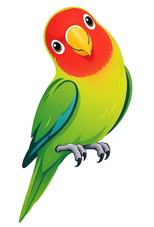

# Yet Another HArness (YAHA)

YAHA is the open-source runtime for **AGLang**, an agent-oriented language in which a program is a set of Markdown agent classes. It runs as a command-line tool that turns a task into a structured execution trajectory: an agent loads its class, walks a prompt chain, calls tools, and can spawn further agents. The design rationale is in the white paper at [`yaha/docs/AOP-White-Paper.md`](yaha/docs/AOP-White-Paper.md).

<br clear="both">


## 🚀 Core Principles

- **Simple**: A program is Markdown - an agent class written in structured natural language, with the low-level machinery of conventional programming kept out of the way.
- **Agent-oriented**: The agent is a first-class citizen. An agent class encapsulates its prompts, workflow, tools and context memory; classes are inheritable and stateful, and the memory folder is indexed automatically at startup.
- **Multi-stage**: A workflow is a prompt chain. Each stage carries its own instructions, tools and entry/exit gates, so arbitrary workflows run over one shared conversation history.
- **Multi-agent**: A parent spawns sub-agents of the same or different classes, sequentially or concurrently, and coordinates them with named events.
- **Distributed**: Native primitives let agents talk across machine boundaries over HTTP(S) and JSON, so a crew can span hosts.
- **Extensible and integration**: Register or disable tools in configuration, add capabilities through the industry-standard Skills interface, and embed Python or Bash with stage hooks.
- **Robust**: Embraces the uncertainty of LLMs - responses are validated and retried, gates at stage boundaries reject unwanted behaviour, and failures route through a structured recovery path.
- **Observability**: Every agent history and runtime log is recorded first-hand for diagnosis and self-learning.
- **Interpreted and portable**: A high-level language executed by an interpreter, so it is architecture-neutral and runs wherever an interpreter is available.

## 🛠 Features

- **Agent Classes**: OOP-style definitions in `AgentClass.md` with inheritance and per-block overrides; a class declares its `Model`, `Toolset`, `Skillset` and `Agentset`.
- **Prompt Chains & Control Tools**: Sequential stages (`Preamble`, custom stages, `Aftermath`) plus reusable `Detached` stages, traversed with `success_tool`, `fail_tool`, `exit_to`, `loop_tool`, `restart` and the `set_event_*` terminators.
- **Durable Memory & Context**: A git-backed `.yaha/memory/` folder indexed at startup, consolidated by `SleepAgent`, and a context-snapshot stage (`Snap Handler: Compression`) that keeps long-horizon runs going. (`.yaha/logs/` is also a git repo, but it ignores its contents by default, so logs are not versioned unless you opt in.)
- **Multi-Agent Crews**: Blocking sub-agents (`yaha_spawn_agent`) and concurrent peers (`spawn_parallel_agent`) bounded by an Agentset and toolset privilege cap, coordinated through named events that auto-reset or latch.
- **Remote Agents (Endpoints)**: Agents reach each other over HTTP endpoints with `connect_tool`, `send_tool`, `bind_tool` and `close_tool`.
- **Tools, Skills & Hooks**: The JSON `tool-schema.md` catalogue, expert skills under `.yaha/skills/` loaded with `load_skill`, and `preenter`/`pretool`/`posttool`/`preexit` hooks that embed Bash or Python.
- **Access Control System (ACS)**:
    - **Filesystem Sandbox**: Strict workspace root enforcement and granular `.yaha` folder protection.
    - **Three-Tier Shell Security**: Whitelist for efficiency, heuristic checks for anomalies, and human-in-the-loop confirmation for dangerous commands.
    - **MacOS Sandbox**: Native `sandbox-exec` integration to protect the host system.
- **Reliable by Design**: Malformed model output is validated and retried, stage gates reject unwanted behaviour, and a `Fail Target` routes failures through a recovery path.
- **Observable**: Per-agent trajectories in `.yaha/logs/`, a structured error log, and an interrupt venue whose `status` dump reports the resolved workspace and log paths.
- **Autonomous Mode**: Use `-y` (Yes-for-All) and `-f` (Force/Unattended) flags for non-interactive execution.
- **Multiple LLM Support**: Gemini, DeepSeek (V4 Flash/Pro/Reasoner) and local models via Ollama, selected per class through `Model.md`.

## 🧰 Companion Tools

Two small tools ship with YAHA; both are installed into a workspace by `yaha --init`.

### Obsidian plugin (`yaha-agents`)

`--init` writes an Obsidian vault configuration into `.obsidian/` and installs the bundled **YAHA Agents** plugin (`yaha/templates/obsidian/plugins/yaha-agents/`). In the editor it adds a *YAHA Agent* context-menu action and an *Invoke YAHA Agent* command, and its settings tab holds your YAHA path and provider API keys. The plugin streams the agent's thoughts and previews its edits as a live diff. Open the current workspace as a vault with:

```bash
yaha --ide
```

### Shell hook (`shell-copilot`)

`--init` also installs the **shell-copilot** hook into `.yaha/shellcopilot/` (the `copilot-hook.sh` script plus its `ShellCopilot.md` class). Source it from your `~/.zshrc` or `~/.bashrc` and your interactive shell gains two abilities:

1. **Error copilot** - when a command exits non-zero, the hook builds a structured report and asks a `ShellCopilot` agent for a concrete fix.
2. **Smart Invoke** - type a bare double-quoted question (for example `"how do I squash the last 3 commits?"`) and it runs a one-pass `NoAgent` ask.

It is configured entirely with `SHELL_COPILOT_*` environment variables and falls back silently to normal shell behaviour if YAHA is unavailable. See [`yaha/templates/shellcopilot/README.md`](yaha/templates/shellcopilot/README.md) for installation and options.

## 🚀 Installation

Install YAHA directly from the source:

```bash
git clone https://github.com/AGLang-Yaha/yaha.git
cd yaha
pip install -e .
```

## 🏗️ Quick Start

1.  **Initialize a workspace**:
    ```bash
    mkdir my-project && cd my-project
    yaha --init
    ```
    This creates the `.yaha/` configuration environment.

2.  **Run a task**:
    ```bash
    yaha "Implement a robust CLI parser and add unit tests"
    ```

3.  **Choose an agent class** by name or 3-letter code:
    ```bash
    yaha -a CodeAgent "fix the failing test"    # or -a Cda
    ```

4.  **List components**:
    ```bash
    yaha --list agents   # available agent classes
    yaha --list skills   # installed expert skills
    yaha --list tools    # registered tools
    yaha --list sessions # recorded runs
    ```

5.  **Check a workspace** without running an agent:
    ```bash
    yaha --compile
    ```

6.  **Upgrade your environment**:
    Synchronize with the latest framework configurations while preserving your local identity:
    ```bash
    yaha --upgrade
    ```

## 📂 The Configuration Ecosystem (`.yaha/`)

- `AgentClass.md`: OOP-style agent definitions; it composes the shared class templates (`base.md`, `const.md`, `utils.md`, `chat.md`, `coder.md`).
- `Model.md`: LLM provider configurations.
- `SOUL.md`: The agent's core identity - a workspace DEFAULT plus optional per-class identity sections (see `yaha/docs/soul.md`).
- `tool-schema.md`: The JSON catalogue of available tools.
- `layout.md`: This workspace-layout reference.
- `ext/`: Workspace-specific agent extensions (Git-controlled).
- `memory/`: Persistent project "wisdom" and specifications (Git-controlled).
- `logs/`: Hierarchical trajectories for every execution attempt.
- `skills/` and `resources/`: Installed skills and their resources.

## 🖥 Advanced Usage

### Recursive Delegation
Standard agents are authorized to spawn specialized sub-agents:
*   **BaseReflector** (`Bar`): Automatically distills wisdom into memory after a task.
*   **SleepAgent** (`Slp`): Periodic maintenance to consolidate and deduplicate memory files.
*   **WebSearch** (`Wsc`): Web-search helper.
*   **GrillMe** (`Grm`): Interviews the user to clarify a task specification.
*   **ChatAgent** (`Cha`): A persistent conversational agent.

YAHA also ships a working coding crew - **Crewlda** (`Cwl`, lead), **CrewCda** (`Cwd`, coder) and **CrewRva** (`Cwr`, reviewer) - built on the single-role **CodeAgent** (`Cda`) and **CodeReviewer** (`Cvr`).

### Multi-Agent Peers
A stage can start a peer with `spawn_parallel_agent`, which returns a handle immediately and keeps running while the parent proceeds; blocking hand-offs use `yaha_spawn_agent`. Peers have isolated context windows but share the workspace and memory, and coordinate through named events.

### Remote Agents (Endpoints)
Agents can talk to each other over an ENDPOINT - a `http(s)://host[:port]/path/version` address that is both an event name and a message queue. A stage that waits on a service endpoint installs the listener; a peer that connects gets its own conversation endpoint, and every reply is an explicit `send_tool` call, so an operator can gate replying per stage. A worked two-agent example - an echo server plus an echo client that asks you for a message, both ordinary agents inheriting `BaseAgent` and started with `yaha -a Eco` / `yaha -a Ecl` - lives in [`examples/echo_agent/`](examples/echo_agent/README.md), with the full reference in [`yaha/docs/agentclass-authoring-guide.md`](yaha/docs/agentclass-authoring-guide.md).

### Extending YAHA
Register or disable tools by editing `tool-schema.md`; add expert capabilities as skills under `.yaha/skills/`; and embed Bash or Python at stage boundaries with stage hooks (`preenter`, `pretool`, `posttool`, `preexit`). See [`yaha/docs/hooks.md`](yaha/docs/hooks.md) for the hook model.

## 📖 Learn

- [The AGLang white paper](yaha/docs/AOP-White-Paper.md) - the design and the buzzwords behind the language.
- [The programming guide](yaha/docs/programming-guide.md) - hands-on AGLang/YAHA programming, from first agent to distributed crews.
- [The AgentClass authoring guide](yaha/docs/agentclass-authoring-guide.md) - the full class/stage reference.
- [Stage hooks](yaha/docs/hooks.md) - embedding Bash and Python in a stage.
- [SOUL identity](yaha/docs/soul.md) - default and per-class identities.
- [Crew environment](yaha/docs/crew-environment.md) - the multi-agent crew contract.

## 📜 License

This project is open-source.
